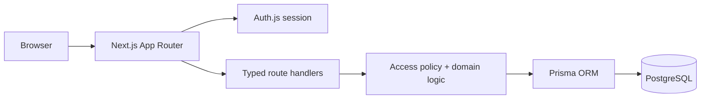

# Finance Showcase

Finance Showcase is a local, educational full-stack application for exploring shared-expense accounting and personal finance organization. It combines a Turkish-language interface with a Next.js/React frontend, typed route handlers, Auth.js sessions, Prisma, and PostgreSQL.

All bundled demonstration users and financial records are intentionally fictional. This project is not financial advice, is not a banking product, and is not presented as production ready or as a live service.

## Implemented features

- email/password registration and Auth.js sessions
- shared groups with owner/member access controls
- expenses with equal, exact, percentage, or share-based splits
- multiple payers, net balances, and simplified settlement suggestions
- personal cash/bank accounts and transactions
- bill reminders and bill-to-transaction linking
- personal portfolio and dashboard summaries
- responsive tables, mobile views, charts, and light/dark themes
- Prisma migrations and guarded synthetic seeding
- unit tests for debt, aggregation, portfolio, and authentication policy
- PostgreSQL integration tests for personal and group resource isolation

## Architecture



See [Architecture](docs/ARCHITECTURE.md), [Security and privacy](docs/SECURITY_AND_PRIVACY.md), and [Limitations](docs/LIMITATIONS.md).

## Requirements

- Node.js 20+
- PostgreSQL 16+
- Docker with Compose, or a local PostgreSQL installation

## Reproducible local setup

1. Install dependencies and create local configuration:

```bash
npm ci
cp .env.example .env
```

2. Replace every `REPLACE_...` value in `.env`. Generate the local Auth.js secret with:

```bash
openssl rand -base64 32
```

3. Start only PostgreSQL, apply migrations, and create synthetic demo data:

```bash
docker compose -f compose.yaml -f compose.dev.yaml up -d database
npm run db:generate
npm run db:migrate
ALLOW_SYNTHETIC_SEED=true npm run db:seed
```

4. Start the application:

```bash
npm run dev
```

Open `http://127.0.0.1:3000`. The synthetic login is `demo.owner@example.com` with password `local-demo-password`. These credentials are local demonstration data, not deployment credentials.

## Validation

```bash
npm run lint
npm test
npm run build
DATABASE_URL="$DATABASE_URL" RUN_DATABASE_TESTS=true npm test -- resource-isolation.integration.test.ts
bash scripts/scan_repository.sh
```

Container startup and browser validation are exercised in CI using ephemeral synthetic data. The default Compose file does not publish PostgreSQL. `compose.dev.yaml` is an explicit local override that binds PostgreSQL to loopback only.

## Authentication boundary

Normal browser use relies on Auth.js. An API-only `X-User-Id` bypass exists for explicit local curl demonstrations, but it is disabled unless `ALLOW_DEMO_AUTH=true` and is always refused in production mode. Do not enable it on a shared system.

## License

Dependencies retain their own licenses. This repository currently has **no project license**, so no permission to copy, modify, or redistribute the project code is granted by default.
