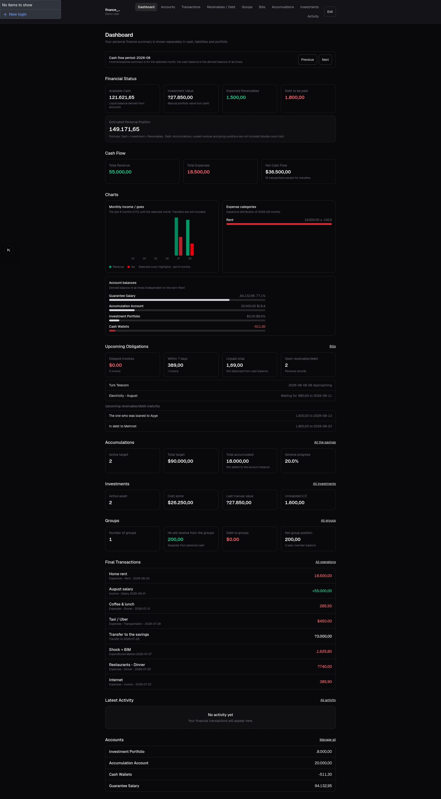
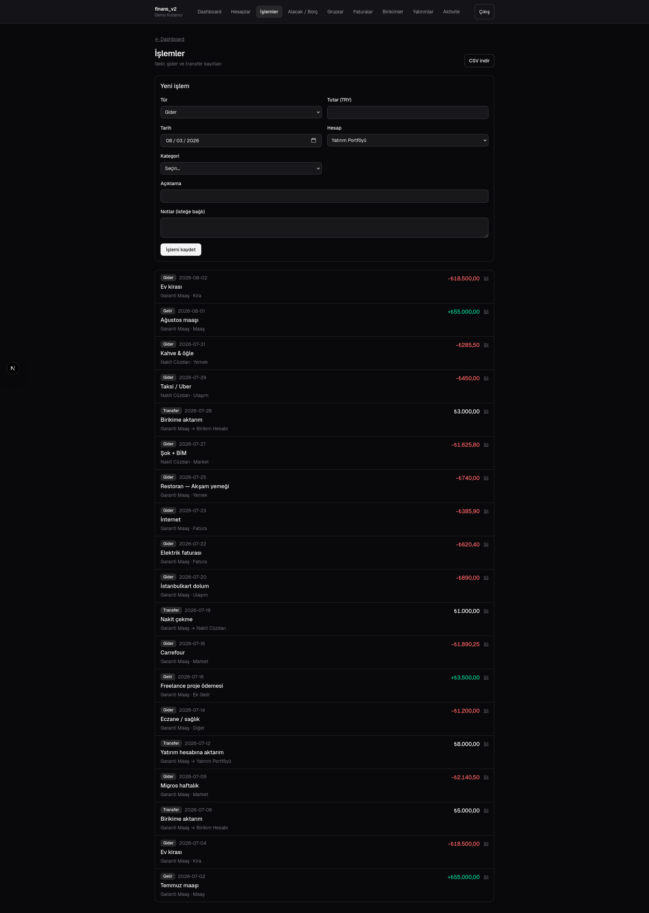
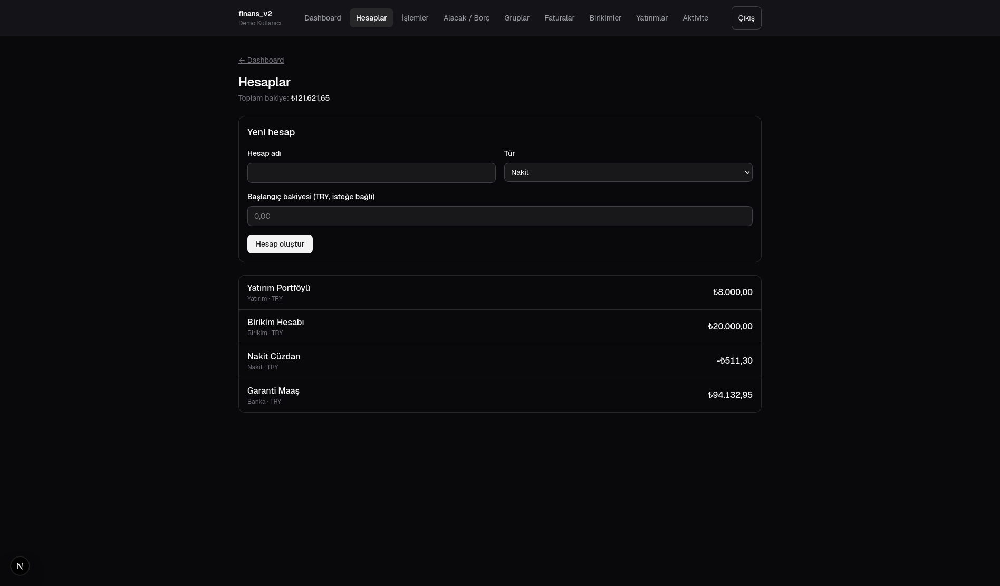
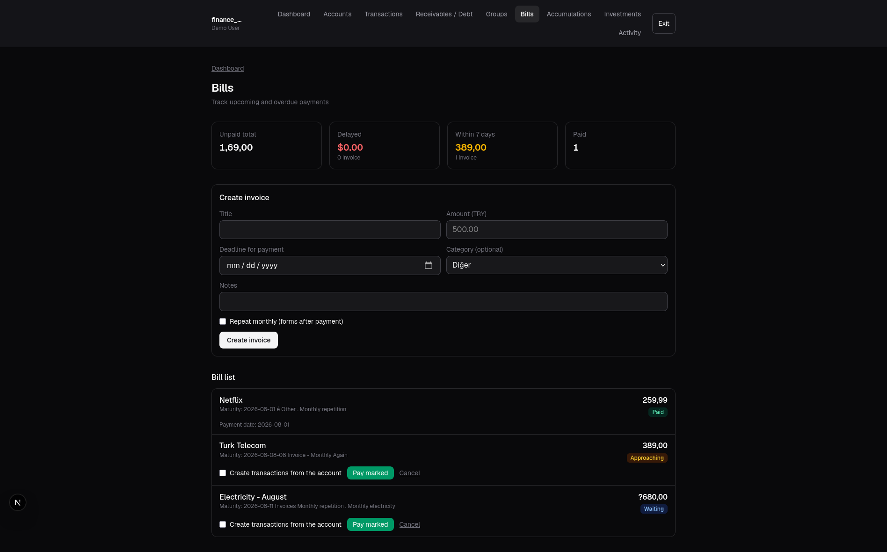
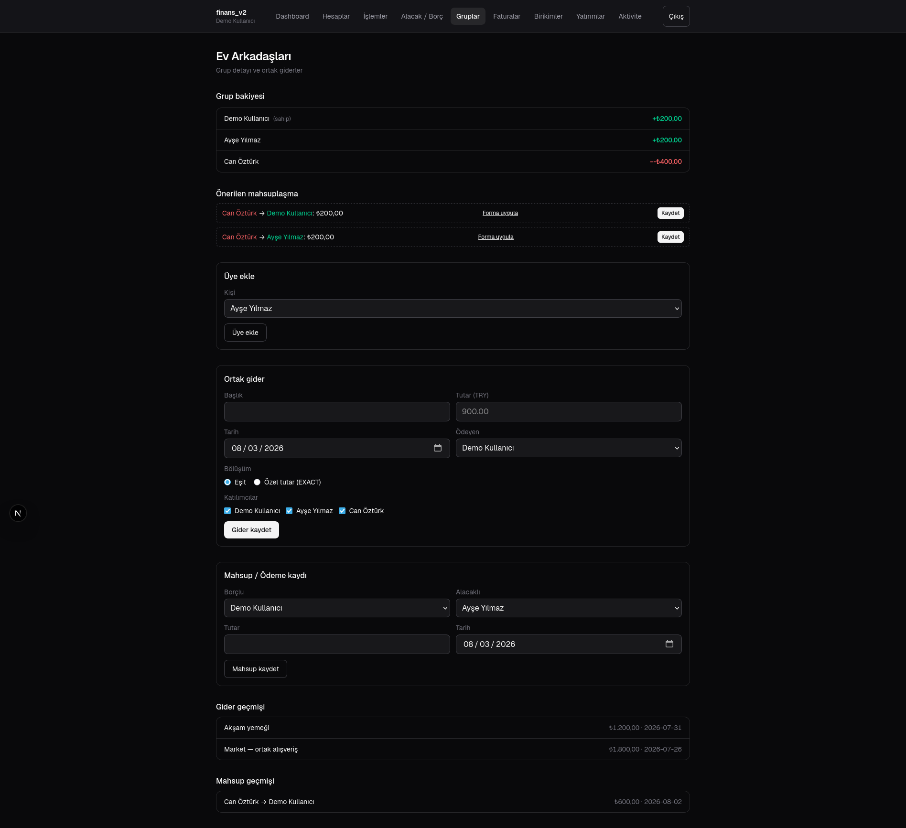
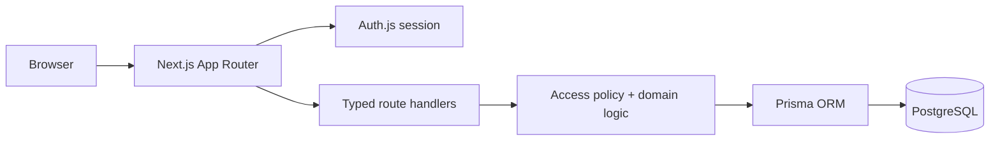

# Finans Platform

Splitting a group expense is easy until several people pay, different split rules apply, and personal financial records must remain invisible to everyone else. Finans Platform is a local, educational full-stack application built around those accounting and authorization boundaries.

It combines a Turkish-language Next.js/React interface with typed route handlers, Auth.js sessions, Prisma, and PostgreSQL. The project demonstrates product development across UI, domain logic, relational modeling, security policy, and reproducible validation.

All bundled demonstration users and financial records are intentionally fictional. This project is not financial advice, is not a banking product, and is not presented as production ready or as a live service.



## Interface preview

| Transactions | Accounts |
|---|---|
|  |  |

| Bills | Shared groups |
|---|---|
|  |  |

The approved presentation captures use demonstration identities and fictional financial values.

## Engineering focus

- translating equal, exact, percentage, and share-based splits into testable domain rules;
- enforcing ownership for personal resources and membership policy for group resources;
- keeping monetary calculations deterministic and persistence-backed;
- failing closed when production authentication configuration is incomplete;
- validating the application against a real PostgreSQL service and browser flow in CI.

## Implemented features

- email/password registration and Auth.js sessions
- shared groups with owner/member access controls
- expenses with equal, exact, percentage, or share-based splits
- multiple payers, net balances, and simplified settlement suggestions
- personal cash/bank accounts and transactions
- bill reminders and bill-to-transaction linking
- personal portfolio and dashboard summaries
- responsive tables, mobile views, charts, and light/dark themes
- Prisma migrations and guarded synthetic seeding
- unit tests for debt, aggregation, portfolio, and authentication policy
- PostgreSQL integration tests for personal and group resource isolation

## Architecture



See [Architecture](docs/ARCHITECTURE.md), [Security and privacy](docs/SECURITY_AND_PRIVACY.md), and [Limitations](docs/LIMITATIONS.md).

### Key engineering decisions

- **Authorization lives beside data access:** personal queries include the authenticated owner; group routes check membership before access.
- **Debt calculation is isolated domain logic:** split validation and settlement matching are pure TypeScript functions with focused tests.
- **Production-like configuration fails closed:** weak secrets and unsafe authentication URLs are rejected.
- **Synthetic seeding is gated:** it requires an explicit non-production flag.
- **The database is private by default:** Compose does not publish PostgreSQL outside its internal network.

## Requirements

- Node.js 20+
- PostgreSQL 16+
- Docker with Compose, or a local PostgreSQL installation

## Reproducible local setup

1. Install dependencies and create local configuration:

```bash
npm ci
cp .env.example .env
```

2. Replace every `REPLACE_...` value in `.env`. Generate the local Auth.js secret with:

```bash
openssl rand -base64 32
```

3. Start only PostgreSQL, apply migrations, and create synthetic demo data:

```bash
docker compose -f compose.yaml -f compose.dev.yaml up -d database
npm run db:generate
npm run db:migrate
ALLOW_SYNTHETIC_SEED=true npm run db:seed
```

4. Start the application:

```bash
npm run dev
```

Open `http://127.0.0.1:3000`. The synthetic login is `demo.owner@example.com` with password `local-demo-password`. These credentials are local demonstration data, not deployment credentials.

## Validation

```bash
npm run lint
npm test
npm run build
DATABASE_URL="$DATABASE_URL" RUN_DATABASE_TESTS=true npm test -- resource-isolation.integration.test.ts
bash scripts/scan_repository.sh
```

Container startup and browser validation are exercised in CI using ephemeral synthetic data. The default Compose file does not publish PostgreSQL. `compose.dev.yaml` is an explicit local override that binds PostgreSQL to loopback only.

The CI release path performs deterministic installation, Prisma migration, linting, 24 unit/integration tests, a production build, a Playwright registration-to-dashboard path, repository security scans, and a container health check.

## Reviewer takeaway

Finans Platform demonstrates end-to-end product ownership: a responsive interface, typed server boundaries, relational data modeling, deterministic accounting rules, user/group authorization, database-backed isolation tests, and reproducible container validation.

## Authentication boundary

Normal browser use relies on Auth.js. An API-only `X-User-Id` bypass exists for explicit local curl demonstrations, but it is disabled unless `ALLOW_DEMO_AUTH=true` and is always refused in production mode. Do not enable it on a shared system.

## License

Dependencies retain their own licenses. This repository currently has **no project license**, so no permission to copy, modify, or redistribute the project code is granted by default.
