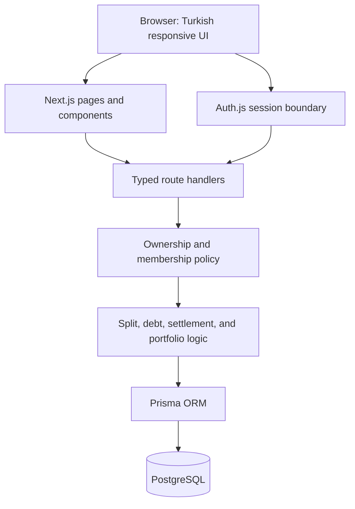
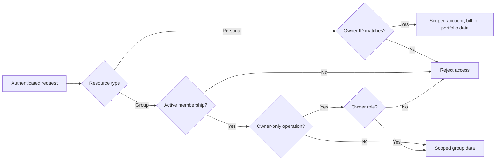

# Architecture

Finance Showcase is one Next.js application. Server-rendered pages and client components consume route handlers in the same deployment; Prisma provides the persistence boundary to PostgreSQL.

## Layers

| Layer | Location | Responsibility |
|---|---|---|
| Pages and layouts | `src/app/` | Navigation, protected surfaces, server rendering |
| UI components | `src/components/` | Forms, tables, charts, responsive views |
| Route handlers | `src/app/api/` | Authentication, validation, HTTP responses |
| Domain helpers | `src/lib/` | Debt splitting, aggregation, access policy, formatting |
| Persistence | `prisma/` | Data model, migrations, synthetic seed |

## Data model

Users own personal accounts, transactions, and bills. Users join shared groups through memberships. Group expenses contain payer records and owed splits; settlements record transfers. All monetary values use PostgreSQL decimal columns with two fractional digits and the showcase supports TRY only.

## Access boundary

Personal queries include the authenticated user identifier. Group routes call the membership policy before reading or mutating group resources; owner-only operations additionally check the membership role. Integration tests create an owner and outsider to verify these boundaries against PostgreSQL.

## Debt calculation

Pure TypeScript functions validate splits and payer totals, compute `paid - owed` net balances, apply settlements, and greedily match debtors with creditors. Unit tests cover supported split modes, multiple payers, rounding, and portfolio aggregation.

## Validation boundary

Pure domain tests run without infrastructure. PostgreSQL integration tests exercise ownership and group isolation using real constraints and migrations. Playwright verifies registration, credential login, session creation, and protected navigation. Container CI separately verifies build, startup, health, and cleanup.
